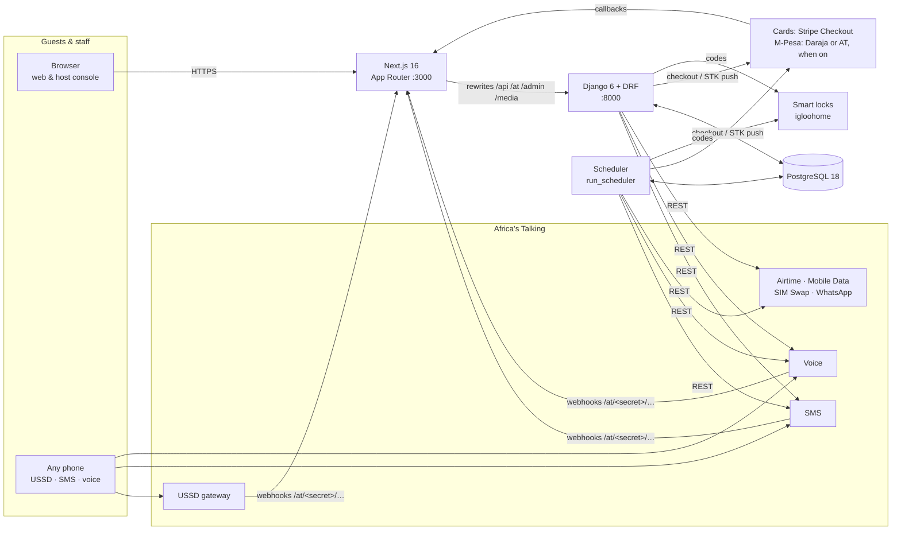
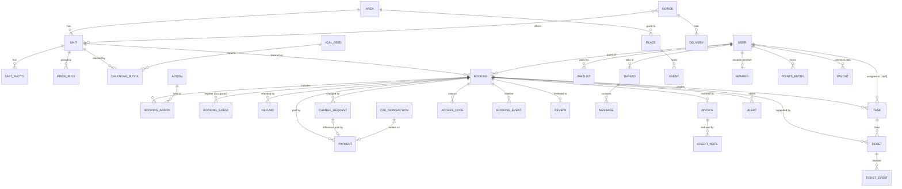
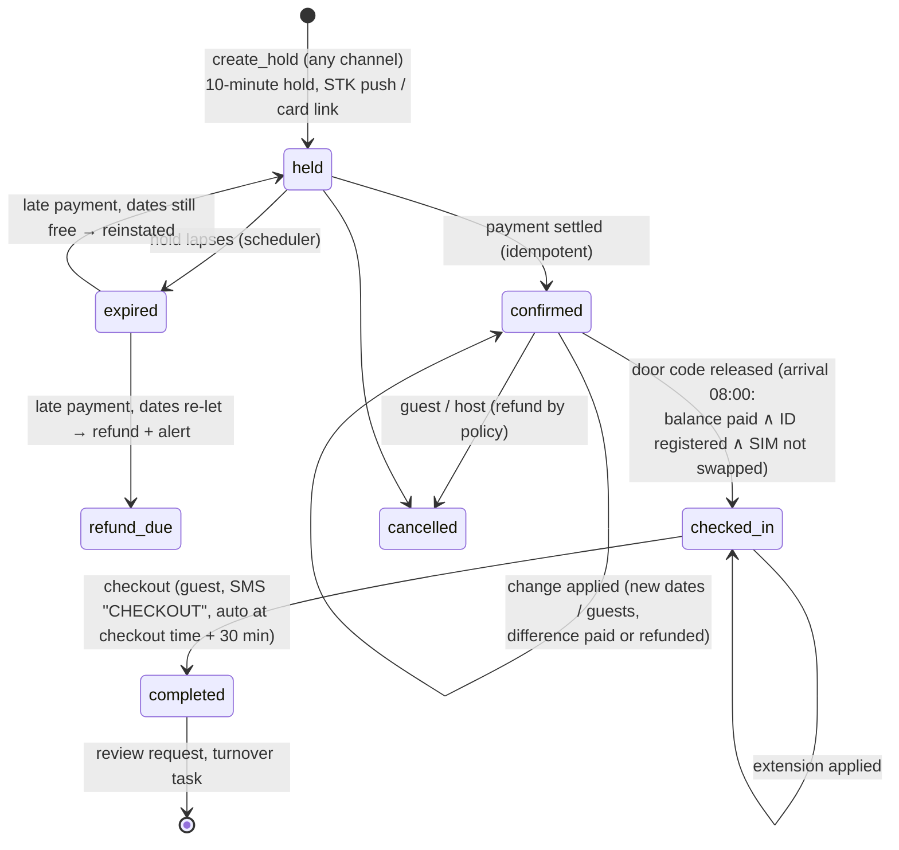

# Architecture

## System overview



There is **one public origin**. Next.js serves the website and proxies the API, admin, media and Africa's Talking webhooks to Django. A single tunnel (ngrok/cloudflared) on port 3000 is all the demo needs, and the browser gets same-origin session cookies with CSRF and no CORS.

In production, Django runs under gunicorn with several workers (`--keep-alive 0`, so the Next.js proxy never reuses a connection gunicorn is about to close). The workers share one cache, a PostgreSQL table created by `migrate`, so login-code limits, throttles and provider access tokens hold across workers and restarts without Redis.

## Backend (Django apps)

| App | Responsibility |
|---|---|
| `core` | Site settings (business details, policies, TRA licence, automation switches), activity/audit log, Fernet encryption, the scheduler (jobs, daily markers, Postgres advisory lock), demo endpoints, seed data |
| `accounts` | Phone-number identity (`User` with roles: guest, owner, manager, cleaner, cook, caretaker, security, driver), OTP login, encrypted ID, preferences, data export/erasure, retention purge |
| `properties` | Areas, units (homes), photos, amenities, price rules and overrides, calendar blocks, iCal feeds (import/export), wishlists; availability and the all-in quote engine |
| `bookings` | Booking lifecycle (hold → confirmed → checked in → completed), date changes and extensions (`ChangeRequest`), add-ons and approvals, breakfast, occupants (guest register), access codes, waitlist, risk screening, refunds quote |
| `payments` | Payments and refunds; providers: Stripe Checkout, simulated card, Paystack, and M-Pesa (off by default: simulated, Safaricom Daraja, AT mobile checkout); idempotent settlement; reconciliation; M-Pesa result-code guidance; Paybill (C2B) matching; invoices, credit notes and the ledger CSV |
| `messaging` | Threads, messages (outbox), multilingual templates, automations (message timeline), FAQ knowledge base, broadcasts, GSM-7 encoding, promo-hours guard |
| `comms` | Africa's Talking REST client; the SMS bot ("Ask Amina") and host SMS commands; USSD state machine; voice IVR; M-Pesa prompts deferred until after a USSD/voice reply; SIM-swap checks; webhooks and Demo Lab endpoints |
| `operations` | Tasks/work orders (turnover, maintenance, guest requests), staff, kitchen sheet, gate list, morning digest, guest CRM |
| `safety` | Alerts and the SOS escalation ladder, follow-ups, guest register CSV |
| `reviews` | Ratings by SMS/web with category scores, host responses |
| `insights` | Occupancy, ADR, RevPAR, channel mix, forward bookings, "Today" view, monthly TRA return |
| `support` | The support desk: tickets with a reference (T12) and a reply-by time from every channel, Amina's replies (console or `T12 …` by SMS), click-to-call bridging through AT Voice, escalation (SMS, then a call), 1–5 ratings; problem-in-the-home tickets follow their work order |
| `notices` | Service alerts: outages, planned maintenance and advisories for some or all homes; who was told what (`Delivery`), heads-ups a day ahead, updates, "it's fixed", the outage data bundle, and the "we already know" answer to duplicate problem reports |
| `guide` | The local guide: places (category, area, hours, price, tips, pin) and events (weekly or dated, yearly), served by USSD, SMS, voice and the web, sorted by distance from the guest's home |
| `rewards` | Points for stays and feedback, invite codes and referral rewards, and the airtime/data ledger (`Payout`) shared by rewards, gifts and outage bundles: idempotency keys, a monthly airtime budget with approval, AT delivery callbacks, points returned on failure |

## Data model (core)



## Booking lifecycle



### No double bookings

1. **Database guarantee.** An exclusion constraint makes PostgreSQL refuse two overlapping live stays (`held`, `confirmed`, `checked_in`) for one unit:
   ```sql
   EXCLUDE USING gist (unit_id WITH =, daterange(check_in, check_out, '[)') WITH &&) WHERE (status IN ('held','confirmed','checked_in'))
   ```
   Back-to-back stays are fine (`[)` ranges).
2. **Serialised holds.** `create_hold` locks the unit row (`SELECT … FOR UPDATE`), expires stale holds and re-checks availability, including iCal blocks from Airbnb and Booking.com, inside one transaction. If the constraint still fires, the `IntegrityError` becomes "Sorry — those dates were just taken".
3. **Tested.** Two threads booking the same dates from USSD and the web at the same instant: exactly one wins (`tests/test_booking_engine.py`).

### Payments

- **Pluggable providers.** `CARD_PROVIDER=stripe|simulate|paystack` (Stripe as soon as `STRIPE_SECRET_KEY` is set) and `MPESA_PROVIDER=off|simulate|daraja|africastalking`. M-Pesa is off until Safaricom's Go-Live: every payment is then a card payment, and `payments.services.can_prompt(phone)` is the one place that decides whether a guest gets an M-Pesa prompt (M-Pesa on, a Kenyan number) or a card link by SMS.
- **Callbacks** live under secret paths. Settlement (`payments.services.on_success`) locks the payment row and is safe to call any number of times. It checks the amount and handles late payments: re-hold if the unit is free, otherwise `refund_due` plus an alert to Amina.
- **Reconciliation.** A scheduler job queries pending STK pushes every 2 minutes, and pending Stripe sessions every run for their first quarter hour, then every 15 minutes until they expire (a session lasts 24 hours at most).
- **Deposits.** 30% now and the balance one day before arrival. The door code waits for the balance, and Kenyan guests get an automatic M-Pesa prompt for it. A daily balance ladder adds a heads-up a week ahead and an overdue SMS with the Paybill details; Amina sees every outstanding balance on the Payments page.
- **Failed prompts.** `payments/results.py` maps each Daraja result code (1 low balance, 1001 another prompt open, 1019 expired, 1025 unreachable, 1032 cancelled, 1037 timeout, 2001 wrong PIN) to the reason Amina sees, the guest's message and the next step: resend, wait, pay the 30% deposit, card or Paybill.
- **Paybill (C2B).** Daraja calls `/api/payments/daraja/c2b/validation|confirmation/<secret>`. A payment whose account number is a booking reference settles that booking (an overpayment is queued as a refund); anything else waits in an Unmatched queue on the Payments page. `manage.py register_c2b` registers the URLs.
- **One payment, two reports.** A prompt's money can also arrive as a Paybill confirmation. With the same M-Pesa code it is counted once. When STK Query settles a prompt, the answer carries no M-Pesa code, so a prompt and a Paybill payment for the same booking and amount within 30 minutes are counted once, in either order. Amina gets an alert to check her statement, saying whether to record or refund a second payment if there was one; the guest is promised nothing until she does.
- **Changes.** A `ChangeRequest` re-prices the stay at current rates and re-checks availability inside one transaction. A higher price is applied when its payment settles (48 h at most, then it lapses); a lower one applies at once and refunds by the cancellation policy. `SiteSettings.instant_changes` off means Amina approves first.
- **Invoices.** Numbered invoices (`AMS-INV-YYYY-NNNNN`, one per booking) and credit notes (`AMS-CN-…`) from a per-year counter, a printable page at `/trips/[ref]/invoice`, and sales-register and ledger CSVs. eTIMS transmission is not built.
- **Cards (Stripe).** A payment opens a Stripe Checkout Session in KES (amounts in cents; 31 minutes for a hold, 23 hours for a balance or a change) with our own `checkout_token` as `client_reference_id`. Stripe sends the guest back to `/pay/card/<token>`, which asks Stripe about the session (throttled to once every 3 s) and settles it; the signed webhook (`checkout.session.*`, HMAC-SHA256 over the raw body, 5-minute tolerance) and the scheduler settle it too. Only a complete, paid session for this payment, in KES and for the full amount counts. The same `/pay/card/<token>` page is the short link texted to USSD, SMS and voice guests. A cancellation refund goes back through Stripe's Refunds API after the transaction commits, split across the stay's Stripe payments (newest first) with an idempotency key per part; a refund that includes cash or M-Pesa money waits for Amina.
- **Cards (Paystack, optional).** Webhooks are HMAC-checked and then confirmed with Verify Transaction (KES, full amount); pending card payments are reconciled like STK pushes.

### Messaging: an outbox

`messaging.send()` writes a `queued` message in the caller's transaction and dispatches it **after commit** (`transaction.on_commit`), so a rolled-back booking never texts the guest. Anything still queued (crash, AT outage) is re-sent by the scheduler. Other behaviour:
- delivery reports update the status (`delivered`, `failed`);
- Africa's Talking status codes decide retries: 402/403/404/406 are final (406 also marks the number as opted out), 405 (no credit) alerts Amina while booking messages wait it out, and 5xx/407/network errors retry after 1 and 5 minutes (3 sends in all);
- inbound messages are de-duplicated by a unique constraint on the provider's message id;
- seeded demo users are never sent real SMS;
- with no AT key, messages are logged (dry run);
- promotional messages are only sent inside the configured hours (08:00–18:00) and never to opted-out numbers.

### Scheduler

`python manage.py run_scheduler` loops every 30 s. A PostgreSQL advisory lock keeps it single-instance even if several are started. Daily jobs run once per day (database markers), so a restart never repeats them.

| Job | When | What |
|---|---|---|
| `expire_holds` | every tick | Lapsed holds → expired; waitlist notified |
| `outbox` | every tick | Re-send queued messages |
| `release_codes` | from the code-release time (08:00) | Door codes for today's arrivals (gates: balance, ID, SIM swap) |
| `automations` | every tick | Message timeline: confirmation → pre-arrival (D-3) → ID request → directions (D-1) → welcome check → mid-stay → checkout reminder → thanks |
| `auto_checkout` | checkout time + 30 min | Completes forgotten checkouts, revokes codes, creates turnover tasks |
| `reviews` | after checkout | SMS review request (reply 1–5) |
| `alert_followups` | every tick | Escalate unacknowledged SOS alerts (calls Amina, then the backup contact) |
| `changes_expire` | every tick | Lapse date changes left unpaid or unapproved past their deadline (applies any that were paid) |
| `service_notices` | every tick | Start planned work on time, send day-ahead heads-ups, tell guests who arrive mid-outage (and send their data bundle), ask Amina once if an outage runs 30 min past its expected end |
| `support_escalation` | 1 min | Tickets past their reply-by time: SMS Amina and the backup; complaints and call-backs still waiting after twice that time ring Amina's phone (low priority waits for the morning) |
| `rewards` | 1 min | Points for stays that just ended and for feedback; airtime to both guests once a referred guest's first stay is over |
| `payments_reconcile` | 2 min | Query pending STK pushes and card payments |
| `ical_sync` | 15 min | Import Airbnb/Booking.com calendars; alert on conflicts |
| `host_digest` | 07:00 | Amina's morning SMS: arrivals, departures, in-house, breakfasts, open tasks, unanswered messages, alerts, week occupancy |
| `gate_list` | 07:30 | Today's arrivals, plates and ETAs to the security guard |
| `kitchen_sheet` | 18:00 | Tomorrow's breakfasts (style, people, time, dietary) to the cook |
| `levy_reminder` | 5th of the month | Last month's tourism levy and TRA return reminder |
| `licence_reminder` | 09:00 | TRA licence renewal: SMS and a compliance alert 45, 30, 14, 7 and 1 days before the expiry date |
| `balance_ladder` | 10:00 | Balance heads-up a week before arrival; overdue SMS with the Paybill details |
| `retention` | 03:00 | Erase ID numbers past the 5-year register period |

## Channels

| Channel | Entry point | Notes |
|---|---|---|
| USSD | `comms/ussd.py` | A cursor replays AT's `*`-joined text chain, so the session is stateless and resilient. Every screen ≤ 160 chars (tested). `0` back, `00` home, `98` more. Guests: 6 Talk to Amina (call-back, a typed question answered on screen from the homes, their calendars and the knowledge base or else relayed to Amina, complaint, my requests) and 8 More (local guide, service status, rewards, language); 9 stays EMERGENCY. Separate menus for staff (tasks) and the host (today, approvals, tonight's availability). The M-Pesa prompt is sent after the `END` reply (`comms/deferred.py`), so a slow payment API can't time out the session. |
| SMS | `comms/smsbot.py` | Keywords in 5 languages, then the conversation state, then NLU (dates, nights, guests, area), then the FAQ knowledge base, then relay to Amina. HELP is checked first, always. Add-ons: `COMPLAIN …`, `CALL ME`, `TICKETS`, `T12`, a 1–5 rating; `EXPLORE` (then numbers), `EVENTS`, `FOOD`; `ALERTS`, `DATA`; `POINTS`, `REDEEM AIRTIME|DATA`, `REFER`, `REF <code>`. A problem report an active alert covers gets the alert. Host commands: `#12 text`, `YES 34`, `NO 34`, `OK`, `T12 text`, `CALL T12`, `RESOLVE T12`, `TICKETS`, `OUTAGE <service> <home\|ALL> …`, `RESTORED 4`, `ALERTS`. Staff: `DONE 7`, `OUTAGE …`, `RESTORED 4`. |
| Voice | `comms/voice.py` | AT voice XML: `<Say>` (Kiswahili voice), `<GetDigits>`, `<Dial>` to Amina, `<Record>` voicemail. DB-backed sessions. Outbound SOS call to Amina ("press 1 to call the guest"). Press 5 records a complaint (the recording becomes a ticket), press 6 reads three local favourites and texts the list. Support call-backs ring Amina first (`clientRequestId` `bridge-<ticket>`) and `<Dial>` the guest when she answers; an escalation call (`ticket-<id>`) offers "press 1 to call them now". A missed bridged call becomes a call-back ticket; an unanswered SOS call escalates at once, and an unanswered welcome call becomes a welcome SMS. |
| Web | `frontend/` | Next.js; the same services as every other channel |

## Security & privacy

- **Auth.**
  - Phone number + 6-digit OTP (hashed): 5-minute expiry, lockout after 5 attempts, 30-second resend gap, 5 codes per number per hour, plus per-IP throttles.
  - Login codes are never stored: the SMS is sent straight from memory, and the outbox, inbox and admin show `••••••` instead.
  - Session cookie (HttpOnly, SameSite=Lax, Secure in production) with CSRF.
- **Roles.** Guest; host (owner/manager); staff (cleaner, cook, caretaker, security, driver). DRF permission classes (`IsGuest`, `IsHost`, `IsStaffMember`). Guests only ever see their own bookings (404 otherwise).
- **Webhooks.** AT doesn't sign callbacks, so they live under `/at/<AT_WEBHOOK_SECRET>/…`; a wrong secret returns 403. The M-Pesa prompt (STK) and Paybill (C2B) callbacks share their own secret path, `DARAJA_CALLBACK_SECRET` (falling back to `AT_WEBHOOK_SECRET`), and Paystack webhooks are HMAC-verified. Stripe webhooks are checked against `STRIPE_WEBHOOK_SECRET` (a bad or stale signature is a 400).
- **Guest IDs.**
  - Encrypted with Fernet; staff see only the last 4 characters. Consent is required.
  - Kept for the legal register period (`id_retention_days`), then purged by the retention job.
  - Self-service export (JSON) and erasure.
- **Staged disclosure.** The address is shown once confirmed; directions, Wi-Fi and the house manual from 48 h before; the door code only after release, and it is revoked at checkout or cancellation.
- **SIM-swap check.** Uses AT Insights before sending a door code to a Kenyan number. A recent swap holds the code and alerts Amina.
- **DEMO mode** (`DEMO=1`) enables the Demo Lab, on-screen login codes and demo shortcuts. All demo endpoints return 404 when it's off (tested).
- **Headers.** Content-Security-Policy (Django 6 native CSP), HSTS (configurable), `X-Frame-Options`. In production the Next.js pages get their own CSP (scripts, styles and API calls only from the site itself, no framing), `X-Frame-Options: DENY`, `nosniff`, a Referrer-Policy and a Permissions-Policy.
- **Go-live check.** `manage.py check --deploy` adds warnings `amina.W001`–`W020` for every key or setting a live site still needs: dry-run SMS, simulated payments, a Stripe test key, a demo host phone, a tunnel URL with live M-Pesa, a missing SMS sender and so on.

## Frontend

- **Next.js 16** App Router with `cacheComponents`. Pages are thin server components. Anything reading `params` or `useSearchParams` sits behind `<Suspense>`, and the interactive views are client components using **TanStack Query** against the same-origin API.
- **Shared queries** `useMe()` and `useConfig()` are hydration-safe: they report "pending" until hydration finishes, so a streamed Suspense boundary never hydrates with data the server HTML didn't have.
- **Design system.** Tailwind CSS v4 tokens in `globals.css`, measured from the live Airbnb product (see [research 06/07](RESEARCH.md#design-language)): ink, hairlines, surfaces, chip grey, brand coral, ocean teal, semantic colours, layered shadows, a 20 px card radius, `bold` capped at 600, the gradient pill CTA. Also Radix primitives (dialog, popover, dropdown, tabs, switch, tooltip), lucide line icons, Fluent Emoji 3D icons (`Icon3D`, files in `public/3d`) and Figtree. Maps use Leaflet with softened OpenStreetMap tiles and price-pill markers, loaded client-only.
- **Routes.**

  | Guest | Host console (`/host`) |
  |---|---|
  | `/` home feed · `/experiences` · `/services` · `/guide` local guide | Today (Today \| Upcoming cards) |
  | `/s` search results + map + filters | Menu (grouped hub) |
  | `/stays/[slug]` listing | Calendar (multi-unit, prices) |
  | `/book/[slug]` checkout | Reservations + detail |
  | `/pay/card/[token]` hosted card page | Messages (inbox) |
  | `/trips`, `/trips/[ref]` trip hub, `/trips/[ref]/invoice` | Tasks, Kitchen |
  | `/messages` | Listings + editor (photos, pricing, rules, check-in info) |
  | `/wishlists` | Guests (CRM) |
  | `/account` | Messaging (templates, automations, FAQ, broadcasts) |
  | `/help`, `/privacy`, `/login` | Reviews, Insights (+ TRA return), Payments |
  | `/demo` Demo Lab | Safety, Channels (AT status, iCal), Settings |
  | | Support desk, Service alerts, Local guide, Rewards & airtime |

## Testing

`cd backend && uv run pytest` runs the suite (629 tests) on a real PostgreSQL test database. It covers:
- pricing;
- the overlap constraint and a concurrent race;
- hold expiry;
- payment idempotency, underpayment and late payments;
- door-code gates (ID, SIM swap);
- checkout, cancellations and refunds;
- USSD screen lengths (a crawl of the whole menu) and USSD booking;
- the SMS bot in Kiswahili, HELP and STOP;
- the voice IVR;
- webhook secrets and delivery reports;
- OTP login, permissions, staged disclosure, the web booking API and iCal round-trips.

End-to-end flow suites walk every journey through the public API the way the web, USSD, SMS and voice channels use it: `test_flows_guest`, `_host`, `_ops`, `_payments`, `_sms`, `_ussd`, `_voice` and `_webhooks`, with shared helpers in `tests/flowkit.py`. `test_flows_addons` covers the Africa's Talking challenge add-ons on every channel: support tickets from SMS, USSD and voice recordings, click-to-call bridging, SMS-then-call escalation, ratings; outage alerts with data bundles, mid-outage arrivals, planned maintenance, staff SMS commands and "we already know" answers; the guide by USSD, SMS conversation and voice; points, redemption with delivery callbacks and refunds, invite codes, the monthly budget and the APIs. Feature suites (`test_feature_bookings`, `_payments`, `_channels`, `_stripe`) cover Stripe Checkout (sessions, the webhook signature, return-page and scheduler settlement, refunds), a site with M-Pesa off on every channel, date changes and extensions, the waitlist, deposits on manual bookings, M-Pesa result codes, Paybill matching, invoices and credit notes, the balance ladder, licence reminders and SMS retry rules; `test_scheduler` covers the core jobs, the single-instance lock and failure isolation.
